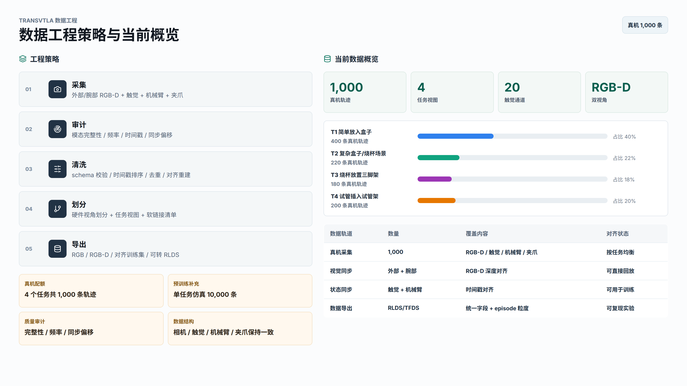
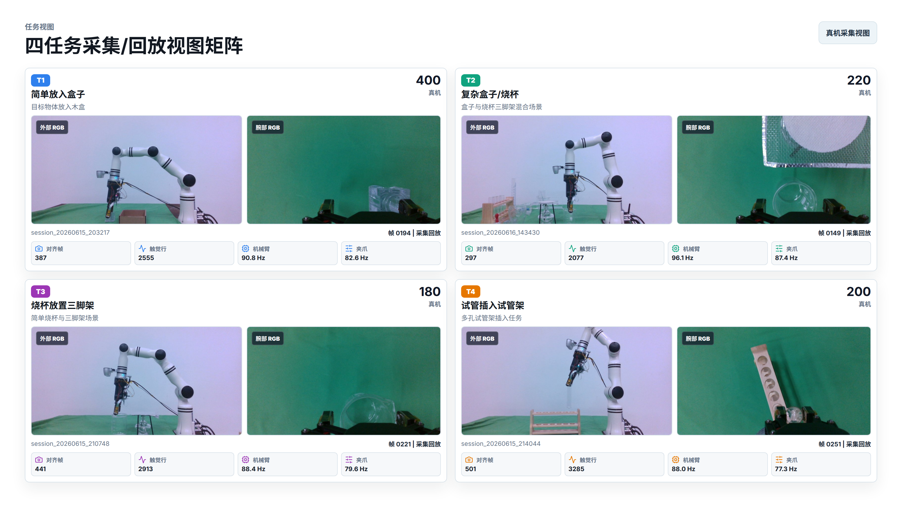

# TransVTLA-RealDataCollect

<p align="center">
  <a href="README.md">中文</a> · <a href="README_EN.md">English</a>
</p>

A real-robot multimodal data collection and data engineering toolkit for TransVTLA experiments. The repository organizes robotic arm state, dual RealSense RGB-D streams, tactile/pressure signals, gripper state, and task labels into an auditable, replayable, cleanable, and exportable workflow for robot learning.

The goal is to turn raw on-site robot experiment recordings into reproducible training assets:

- Collection: synchronized dual RGB-D, robot arm state, gripper state, and tactile/pressure logging.
- Replay: offline inspection of visual, depth, robot, gripper, and tactile streams.
- Audit: frequency, timestamp, modality-completeness, and cross-modal alignment checks.
- Cleaning: reproducible fixes for timestamps, abnormal tactile channels, duplicate gripper states, and alignment tables.
- Export: task split materialization and RLDS/TFDS conversion for downstream VLA training.

## Data Engineering Overview





## Project Scope

This repository consolidates the data side of real-robot experiments:

| Track | Scale | Coverage | Purpose |
| --- | ---: | --- | --- |
| Real-robot data | 1,000 trajectories | External/wrist RGB-D, tactile, robot arm, gripper | Real collection and replay |
| Task views | 4 task categories | Box placement, complex box/beaker, beaker-tripod, test-tube rack | Training and evaluation splits |
| Simulation pretraining | 10,000 trajectories | Single-task simulation data | Pretraining supplement |

Four real-robot task quotas:

| Task | Real trajectories |
| --- | ---: |
| T1 simple box placement | 400 |
| T2 complex box / beaker | 220 |
| T3 beaker on tripod | 180 |
| T4 test tube into rack | 200 |

## Quick Entry Points

### Web Slides

```bash
cd data-engineering-ppt
npm install
npm run react
```

URLs:

- Home: `http://localhost:5178/`
- Slide 2: `http://localhost:5178/?slide=2`
- Export mode: `http://localhost:5178/?slide=1&export=1`

Exported PNG files:

- `data-engineering-ppt/exports/slide-1-data-strategy.png`
- `data-engineering-ppt/exports/slide-2-task-views.png`

### Python Environment

Use a Python virtual environment and install the basic dependencies:

```bash
pip install opencv-python numpy keyboard
pip install pyrealsense2
```

Notes:

- `pyrealsense2` must match the local RealSense driver and Python version.
- Robot-arm scripts depend on the bundled `Robotic_Arm/` SDK.
- GUI collection and replay scripts depend on PySide6.

## Core Capabilities

- Dual RealSense RGB-D capture: external view and wrist view RGB/depth streams.
- Robot arm state logging: joint angles, end-effector pose, and software state.
- Gripper state logging: position, speed, current, force, and error codes through the official RM Plus interface.
- Tactile/pressure logging: standardized 20-channel tactile data.
- Offline replay: frame-level inspection of RGB-D, robot state, gripper state, and tactile data.
- Dataset cleaning: schema validation, abnormal channel interpolation, timestamp sorting, gripper deduplication, and alignment-table rebuilding.
- Task splitting: manifest and symlink-view generation by hardware view and task label.
- Training export: RGB-D RLDS/TFDS conversion entry points.

## Repository Layout

| Path | Purpose |
| --- | --- |
| `collect_data.py` | Main real-robot multimodal collection program with PySide6 UI |
| `data_viewer.py` | Offline session replay tool |
| `test_frequency.py` | Pre-collection frequency check tool |
| `collectors/` | Camera, robot arm, gripper, and pressure collector wrappers |
| `Robotic_Arm/` | RealMan robotic arm Python SDK |
| `scripts/audit_dataset.py` | Dataset audit for modalities, frequency, timestamps, and synchronization |
| `scripts/clean_dataset.py` | Dataset cleaning and alignment rebuilding |
| `scripts/materialize_split_layout.py` | Non-destructive split views by hardware layout |
| `scripts/materialize_task_splits.py` | Four-task split views by task labels |
| `scripts/build_task_preview_sheets.py` | Contact sheets for task annotation |
| `Phase2_build_RLDSdata.py` | Convert collected sessions to RLDS/TFDS |
| `calibration/` | Camera extrinsics, hand-eye calibration, and diagnostic scripts |
| `docs/` | Data format, collection optimization, and repair-plan documents |
| `data-engineering-ppt/` | Web slides and exported high-resolution images |

## Standard Session Layout

```text
sessions/
  session_YYYYMMDD_HHMMSS/
    world_camera/
      rgb/
      depth/
    wrist_camera/
      rgb/
      depth/
    camera_metadata.json
    frames.csv
    aligned_timesteps.csv
    robot_state/
      robot_state.csv
      gripper_state.csv
    pressure/
      pressure.csv
```

Key modalities:

- `world_camera/rgb/`: external RealSense RGB images.
- `world_camera/depth/`: external RealSense depth images, `uint16 PNG` in millimeters.
- `wrist_camera/rgb/`: wrist RealSense RGB images.
- `wrist_camera/depth/`: wrist RealSense depth images, `uint16 PNG` in millimeters.
- `frames.csv`: visual frame timestamps.
- `aligned_timesteps.csv`: alignment indices across vision, tactile, robot, and gripper streams.
- `camera_metadata.json`: RealSense profiles, intrinsics, distortion, serial numbers, and depth scale.
- `robot_state/robot_state.csv`: robot joint and end-effector states.
- `robot_state/gripper_state.csv`: gripper states.
- `pressure/pressure.csv`: standardized 20-channel tactile data.

Legacy `dji/` + `realsense_rgb/` + `realsense_depth/` sessions are still readable by replay, audit, and conversion scripts.

## Common Commands

### Pre-collection Frequency Checks

```bash
python test_frequency.py --sensor dual_realsense --duration 30
python test_frequency.py --sensor pressure
python test_frequency.py --sensor robot
```

### Real-Robot Multimodal Collection

```bash
python collect_data.py
```

### Offline Replay

```bash
python data_viewer.py --session path/to/session_YYYYMMDD_HHMMSS
```

### Dataset Audit and Cleaning

```bash
python scripts/audit_dataset.py --root sessions/
python scripts/clean_dataset.py --root sessions/
```

### Task View Materialization

```bash
python scripts/materialize_task_splits.py --root sessions/
python scripts/materialize_split_layout.py --root sessions/
```

## Recommended Workflow

1. Run frequency checks for cameras, pressure sensors, and the robot arm.
2. Collect sessions with `collect_data.py`.
3. Replay selected sessions with `data_viewer.py`.
4. Run dataset audit and inspect modality/timestamp issues.
5. Clean sessions with reproducible scripts.
6. Materialize task splits and hardware-view splits.
7. Export RLDS/TFDS data for downstream VLA training.

## Notes

- Keep raw collection sessions immutable; run cleaning scripts with backups enabled.
- Verify RealSense serial numbers, depth scale, and camera profiles before long collection runs.
- The standard tactile schema uses 20 effective channels; raw 64-channel pressure packets are only for debugging.
- Hardware drivers, RealSense runtime, and robot SDK versions can affect collection stability.

## License and Notice

This repository is intended for research and engineering use around real-robot data collection. Check the bundled SDK licenses and hardware vendor requirements before redistribution.
